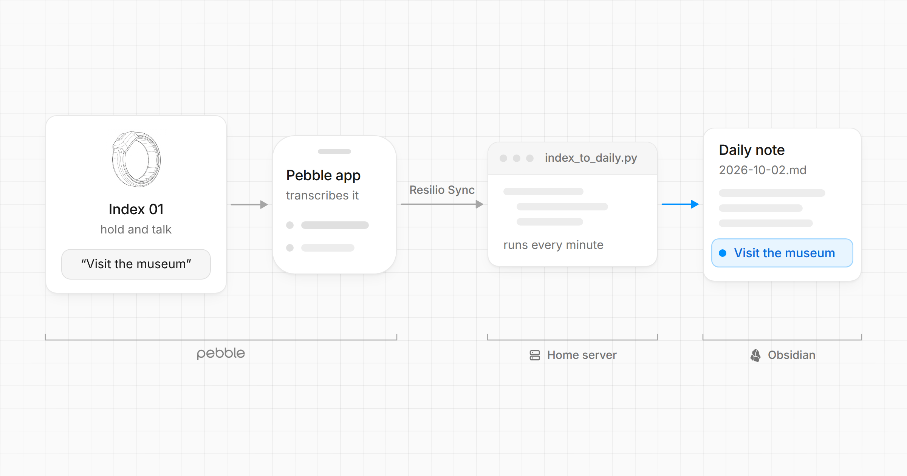

# pebble-index

Two small scripts for the [Pebble Index 01](https://repebble.com/index), a ring you hold and talk into:

- **`index_to_daily.py`** appends each recording to your Obsidian daily note.
- **`pebble_hook.py`** lets you ask an [OpenClaw](https://github.com/openclaw/openclaw) agent a
  question from the ring and get the answer on Telegram.

How and why I use them: [How I Capture Every Thought with a Ring](https://rblab.com/posts/how-i-capture-every-thought-with-a-ring/).

Both are standard-library Python 3.11+, with tests:

```sh
python3 -m unittest discover -s tests -v
```

## index_to_daily.py

<picture>
  <source media="(prefers-color-scheme: dark)" srcset="docs/pipeline-dark.png">
  
</picture>

The Pebble app's Obsidian integration writes one file per recording into
`Voice notes/YYYY-MM-DD HHmm.md` (frontmatter `created:` and `tags: [index]`). It can't append
to today's daily note, so this script does, on any computer that has your vault. Each run:

1. picks up capture files tagged `index` that are at least 90 s old, so sync has finished writing them
2. appends the transcript as a plain paragraph to `Daily notes/<created date>.md`, creating the
   note if it doesn't exist
3. moves the capture into the vault's `.trash/` (Obsidian's local trash, so it's recoverable)

It skips a daily note edited in the last 60 s (you may be typing in it on another device),
writes atomically, and keeps a state file (`~/.local/state/pebble-index/processed.json`) so a
failed move never appends the same recording twice.

**It assumes my vault layout:** captures in `Voice notes/`, one `Daily notes/YYYY-MM-DD.md` per
day, and my frontmatter (`DAILY_STUB`) on any daily note it creates. If yours differs, change
those in the script first.

```sh
VAULT=~/Obsidian python3 index_to_daily.py --dry-run   # show what it would do, change nothing
VAULT=~/Obsidian python3 index_to_daily.py             # VAULT (or --vault) is required
```

### Run it every minute

Linux, with systemd: set your vault and checkout paths in `ops/index-to-daily.service`, then

```sh
cp ops/index-to-daily.{service,timer} ~/.config/systemd/user/
systemctl --user daemon-reload
systemctl --user enable --now index-to-daily.timer
journalctl --user -u index-to-daily -f
```

macOS or Linux, with cron (`crontab -e`):

```
* * * * * VAULT="$HOME/Obsidian" /usr/bin/python3 /path/to/pebble-index/index_to_daily.py
```

## pebble_hook.py

The Pebble app can POST each recording to a webhook, set per gesture, but sends multipart form
data with the gesture in an `X-Index-Trigger` header
([webhook docs](https://developer.repebble.com/index-01/webhooks/)). OpenClaw's hooks only take
JSON, so this small server sits in between:

1. checks the app's `Authorization: Bearer <PEBBLE_HOOK_TOKEN>` header
2. forwards only `double-click-hold` recordings (and the app's "Send test event"); other gestures get 204
3. posts the transcript to an OpenClaw hook mapping (`POST /hooks/ring`), which runs it in your
   Telegram chat with the agent and replies there. The session is persistent, so follow-ups
   keep their context.

The message it sends the agent (`build_agent_payload`) mentions a daily question my agent asks
me; reword it for yours.

### Install

```sh
# secrets (mode 600): PEBBLE_HOOK_TOKEN, OPENCLAW_HOOK_TOKEN (= openclaw.json hooks.token),
# optional PEBBLE_HOOK_SECRET (request signing, see Security)
$EDITOR ~/.config/pebble-index/hook.env
cp ops/pebble-hook.service ~/.config/systemd/user/   # set your checkout path in it first
systemctl --user daemon-reload
systemctl --user enable --now pebble-hook.service
tailscale serve --bg --https=8444 http://127.0.0.1:8444     # tailnet only, no Funnel
journalctl --user -u pebble-hook -f
```

Optional env: `OPENCLAW_HOOK_URL` (default `http://127.0.0.1:18789/hooks/ring`) and
`PEBBLE_HOOK_BIND` (default `127.0.0.1:8444`).

OpenClaw side (`~/.openclaw/openclaw.json`, hot-reloaded). The session key is fixed in the
mapping, so callers still can't pick sessions (`allowRequestSessionKey: false`):

```json5
hooks: {
  enabled: true, token, path: "/hooks", allowedAgentIds: ["main"], allowRequestSessionKey: false,
  allowedSessionKeyPrefixes: ["hook:", "agent:main:telegram:direct:<chat id>"],
  mappings: [{
    id: "pebble-ring", match: { path: "ring" }, action: "agent", agentId: "main",
    name: "Pebble Index", messageTemplate: "{{message}}",
    sessionKey: "agent:main:telegram:direct:<chat id>", sessionMode: "persistent",
    deliver: true, channel: "telegram", to: "<chat id>",
  }],
}
```

In the Pebble app, Index 01 Settings → Webhook → **Double click & hold**: URL
`https://<host>.<tailnet>.ts.net:8444/index`, What to send **Transcription**, header
`Authorization` = `Bearer <PEBBLE_HOOK_TOKEN>`. "Send test event" should get a Telegram reply.

### Security

Keep the bridge inside your tailnet: never expose it with `tailscale funnel`. The bearer token
is all that stands between the webhook and an agent that can run commands.

For a second lock, turn on request signing for the **Double click & hold** gesture in the app
with a random secret (`openssl rand -hex 32`) and set the same value as `PEBBLE_HOOK_SECRET`.
The bridge then refuses unsigned requests, timestamps more than five minutes off, and delivery
IDs it has already seen, as the app's webhook docs recommend.

## License

MIT
